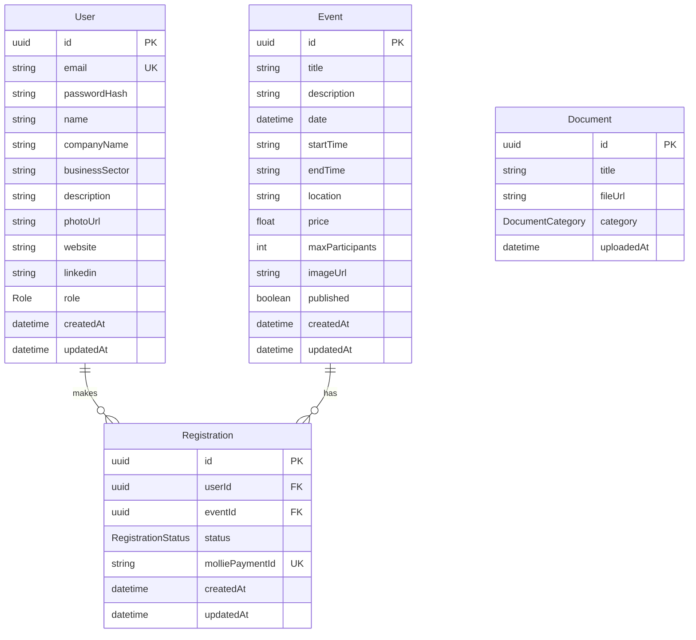
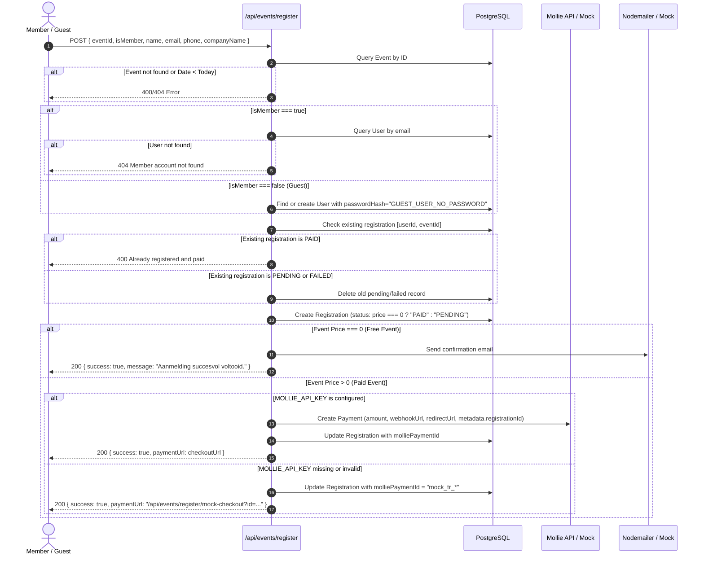

# FEATURES.md — System Specification & Domain Truth

> **Specification-Driven Development (SDD) Contract**  
> This document is the single source of truth for all domain models, business workflows, user interface views, and business rules within the UVON Noord-Brabant application.  
> **Development Rule:** No code may be written or modified without an approved specification change in this document first.

---

## 1. Domain Models

All persistent entities are stored in PostgreSQL and managed through Prisma.

### 1.1 Enumerations

#### `Role`

- `MEMBER`: Regular registered member with access to the member directory and member portal (`/leden/profiel`).
- `ADMIN`: Board member with full access to the member portal plus the Admin Dashboard (`/admin`) and administrative API routes (`/api/admin/*`).

#### `RegistrationStatus`

- `PENDING`: Registration initiated for a paid event; payment has not yet been confirmed by Mollie.
- `PAID`: Completed registration (either free event or successful payment via Mollie/mock sandbox).
- `FAILED`: Payment failed, was canceled by user, or expired in Mollie.

#### `DocumentCategory`

- `MINUTES`: Meeting minutes (e.g., Algemene Ledenvergadering - ALV).
- `FINANCIAL`: Annual financial reports, balance sheets, and budget overviews.
- `OTHER`: General statutes, governance documents, or miscellaneous materials.

---

### 1.2 Entities & Relationships

#### `User`

Represents members, board administrators, applicants, and guests.

- `id` (UUID, Primary Key): Unique identifier.
- `email` (String, Unique): Primary authentication identifier and contact address.
- `passwordHash` (String): Bcrypt hash of the user's password OR a sentinel status value:
  - `"DEACTIVATED_PENDING_APPROVAL"`: Applicant account waiting for board verification.
  - `"GUEST_USER_NO_PASSWORD"`: Ephemeral account created to satisfy registration relational integrity.
- `name` (String): Full name of the member or guest.
- `companyName` (String, Optional): Business name.
- `businessSector` (String, Optional): Industry / sector (set to `"Gast"` for guest registrations).
- `description` (Text, Optional): Biography or company profile.
- `photoUrl` (String, Optional): Hosted or Unsplash profile portrait URL.
- `website` (String, Optional): External URL to the member's website.
- `linkedin` (String, Optional): Profile URL on LinkedIn.
- `role` (`Role`, Default: `MEMBER`): Role level (`MEMBER` or `ADMIN`).
- `createdAt` (DateTime, Default: `now()`): Creation timestamp.
- `updatedAt` (DateTime, Auto-updated): Last modification timestamp.
- _Relations:_ `registrations` -> Array of `Registration` records.

#### `Event`

Represents monthly networking meetings, summer outings, speaker sessions, and annual dinners.

- `id` (UUID, Primary Key): Unique identifier.
- `title` (String): Event headline.
- `description` (Text): Full program description and details.
- `date` (DateTime): Calendar date of the event.
- `startTime` (String): e.g., `"18:00"`.
- `endTime` (String): e.g., `"21:30"`.
- `location` (String): Venue name and city.
- `price` (Float, Default: `0.0`): Ticket price in EUR. `0.0` indicates free admission.
- `maxParticipants` (Integer, Optional): Attendance capacity limit (null = unlimited).
- `imageUrl` (String, Optional): Media image URL.
- `published` (Boolean, Default: `false`): Visibility toggle. Drafts are only visible to admins.
- `createdAt` / `updatedAt` (DateTime).
- _Relations:_ `registrations` -> Array of `Registration` records.

#### `Registration`

Links a `User` to an `Event`.

- `id` (UUID, Primary Key): Unique identifier.
- `userId` (UUID, Foreign Key -> `User.id`, Cascade Delete).
- `eventId` (UUID, Foreign Key -> `Event.id`, Cascade Delete).
- `status` (`RegistrationStatus`, Default: `PENDING`).
- `molliePaymentId` (String, Unique, Optional): External Mollie payment identifier (`tr_*` or `mock_tr_*`).
- `createdAt` / `updatedAt` (DateTime).
- _Constraints:_ Compound unique index `@@unique([userId, eventId])`. A user cannot hold duplicate registrations for the same event.

#### `Document`

Association documents accessible to logged-in members.

- `id` (UUID, Primary Key): Unique identifier.
- `title` (String): Human-readable document title.
- `fileUrl` (String): Path or URL to the downloadable PDF/asset.
- `category` (`DocumentCategory`, Default: `MINUTES`).
- `uploadedAt` (DateTime, Default: `now()`).

---

## 2. Core Workflows

### 2.1 Event Registration Flow (`POST /api/events/register`)

### 2.2 Payment Webhook Processing (`POST /api/events/webhook`)

1. Mollie sends `id` (paymentId) via `application/x-www-form-urlencoded`.
2. Handler initializes Mollie client and fetches payment details using `mollieClient.payments.get(paymentId)`.
3. Extracts `registrationId` from `payment.metadata.registrationId`.
4. Queries `Registration` with related `User` and `Event`.
5. Evaluates payment status:
   - `paid`: Sets `Registration.status = "PAID"`, triggers HTML/plain confirmation email to user via Nodemailer.
   - `failed` | `canceled` | `expired`: Sets `Registration.status = "FAILED"`.
6. Always returns `200 OK` to Mollie to acknowledge delivery.

### 2.3 Simulated Mock Checkout (`GET & POST /api/events/register/mock-checkout`)

- **GET:** Renders an internal payment simulation page displaying event title, user name, email, price, and two action buttons: "Simuleer Betaling Gelukt (PAID)" and "Simuleer Betaling Mislukt (FAILED)".
- **POST:** Receives `registrationId` and chosen status:
  - If `paid`: Updates registration to `PAID`, sends confirmation email, redirects to `/evenementen/[id]?payment=success`.
  - If `failed`: Updates registration to `FAILED`, redirects to `/evenementen/[id]?payment=failed`.

### 2.4 Membership Application Flow (`POST /api/members/apply`)

1. Candidate submits form on `/leden/lid-worden` with `name`, `email`, `phone`, `companyName`, `businessSector`, `website`, `linkedin`, `description`.
2. System verifies mandatory fields and checks email uniqueness.
3. User record created in database with:
   - `passwordHash = "DEACTIVATED_PENDING_APPROVAL"`
   - `role = "MEMBER"`
4. Notification email sent to association admin address (`CONTACT_EMAIL_TO`).
5. Account remains deactivated. Candidate cannot log in.
6. Board reviews application in `/admin` (Leden tab).
7. Board approves candidate by setting their password via `PUT /api/admin/members`.
8. User is now active and can log in at `/leden/login`.

### 2.5 Contact Form Submission (`POST /api/contact`)

1. Visitor submits `name`, `email`, `subject`, `message`.
2. Handler validates required fields.
3. If SMTP environment variables (`SMTP_HOST`, `SMTP_USER`, `SMTP_PASSWORD`) are present:
   - Sends email to `CONTACT_EMAIL_TO` with `replyTo: email`.
4. If SMTP environment variables are missing:
   - Logs `[MOCK EMAIL SENT]` to console without error.
5. Returns `{ success: true, message: "Bericht succesvol verzonden." }`.

### 2.6 Member Profile Management (`POST /api/members/update`)

1. Requires active NextAuth session (`getServerSession(authOptions)`).
2. Allows updating `name`, `companyName`, `businessSector`, `description`, `photoUrl`, `website`, `linkedin`.
3. **Password Change:**
   - Both `currentPassword` and `newPassword` (>= 6 chars) must be provided.
   - Verifies `currentPassword` against current `passwordHash` using `bcrypt.compare`.
   - Hashes `newPassword` with salt rounds 10 and stores updated hash.

### 2.7 Board Administration (`/admin` & `/api/admin/*`)

All `/admin` pages and `/api/admin/*` endpoints strictly require a session where `(session.user as any).role === "ADMIN"`.

- **Events CRUD (`/api/admin/events`):**
  - `GET`: Lists all events ordered by date descending.
  - `POST`: Creates new event (supports drafts via `published = false`).
  - `PUT`: Updates existing event.
  - `DELETE`: Deletes event by ID (cascades to registrations).
- **Members CRUD (`/api/admin/members`):**
  - `GET`: Lists all users ordered alphabetically.
  - `POST`: Manually creates a member with a password.
  - `PUT`: Updates member details, changes role, or approves pending applications by setting their initial password.
  - `DELETE`: Removes member (cascades registrations).
- **Documents CRUD (`/api/admin/documents`):**
  - `GET`: Lists all association documents.
  - `POST`: Registers a new document title, file URL, and category.
  - `DELETE`: Removes document record.

---

## 3. Views & User Interface

| Route                                | View / Page Component                  | Allowed Roles     | Data Dependencies                                                 | Description                                                                                                    |
| :----------------------------------- | :------------------------------------- | :---------------- | :---------------------------------------------------------------- | :------------------------------------------------------------------------------------------------------------- |
| `/`                                  | `src/app/page.tsx`                     | All (Public)      | Next 3 upcoming published events (`Event.date >= today`)          | Homepage with Hero, association pillars, next events carousel, member CTA.                                     |
| `/evenementen`                       | `src/app/evenementen/page.tsx`         | All (Public)      | All upcoming published events                                     | Public agenda showing upcoming dinners, workshops, and gatherings with cards.                                  |
| `/evenementen/[id]`                  | `src/app/evenementen/[id]/page.tsx`    | All (Public)      | Single `Event` by UUID                                            | Detailed event program, location, time, capacity, and `EventRegistrationForm`.                                 |
| `/evenementen/archief`               | `src/app/evenementen/archief/page.tsx` | All (Public)      | Past published events (`Event.date < today`)                      | Archive of historical UVON events.                                                                             |
| `/leden`                             | `src/app/leden/page.tsx`               | All (Public)      | All active users (`passwordHash != DEACTIVATED_PENDING_APPROVAL`) | Filterable directory (`MembersList`) searchable by name, company, sector.                                      |
| `/leden/lid-worden`                  | `src/app/leden/lid-worden/page.tsx`    | All (Public)      | None                                                              | Comprehensive application form submitting to `/api/members/apply`.                                             |
| `/leden/login`                       | `src/app/leden/login/page.tsx`         | All (Public)      | NextAuth `signIn`                                                 | Email/password login form with Dutch error messaging.                                                          |
| `/leden/profiel`                     | `src/app/leden/profiel/page.tsx`       | `MEMBER`, `ADMIN` | Current `User`, all `Document`s, user's `Registration`s           | Member portal with `ProfileEditForm`, internal document downloads, and registration history.                   |
| `/admin`                             | `src/app/admin/page.tsx`               | `ADMIN` only      | All `User`s, `Event`s, `Registration`s, `Document`s               | Board management portal (`AdminDashboard`) with tabs for stats, events, registrations, members, and documents. |
| `/organisatie/bestuur-en-commissies` | `.../bestuur-en-commissies/page.tsx`   | All (Public)      | Static                                                            | Board members, committee profiles, and association background.                                                 |
| `/organisatie/privacyverklaring`     | `.../privacyverklaring/page.tsx`       | All (Public)      | Static                                                            | AVG / GDPR privacy policy.                                                                                     |
| `/contact`                           | `src/app/contact/page.tsx`             | All (Public)      | None                                                              | Contact information and form submitting to `/api/contact`.                                                     |

---

## 4. Business Rules & Constraints

### 4.1 Authentication & Authorization

1. **Pending Approval Lockdown:** Users with `passwordHash === "DEACTIVATED_PENDING_APPROVAL"` are strictly forbidden from logging in. NextAuth returns: _"Uw lidmaatschapsaccount is nog in afwachting van goedkeuring door het bestuur."_
2. **Guest Login Lockdown:** Users created as guests have `passwordHash === "GUEST_USER_NO_PASSWORD"` and cannot authenticate via NextAuth credentials.
3. **Admin Route Protection:** Any request to `/admin` or `/api/admin/*` must have an active session with `role === "ADMIN"`. Unauthorized requests to `/admin` redirect to `/leden/login`; API requests return HTTP 401 with `{ error: "Niet geautoriseerd." }`.
4. **Member Profile Protection:** Unauthenticated requests to `/leden/profiel` or `/api/members/update` return HTTP 401 / redirect to `/leden/login`.
5. **Session Duration:** NextAuth JWT sessions are valid for 30 days (`maxAge: 30 * 24 * 60 * 60`).

### 4.2 Events & Registrations

1. **Past Event Ineligibility:** Users cannot register for an event whose `date < today`. The API rejects with HTTP 400 _"Deze bijeenkomst heeft al plaatsgevonden."_ and the UI hides the registration form.
2. **Single Registration Constraint:** A user may only have one active registration per event. Duplicate registrations for already `PAID` attendees are rejected with HTTP 400.
3. **Pending Registration Replacement:** If a user initiates a registration when an existing registration is in `PENDING` or `FAILED` state, the old registration is replaced.
4. **Free Event Bypass:** Events with `price === 0.0` bypass Mollie completely, mark the registration as `PAID` immediately, and send a confirmation email.
5. **Mollie Fallback:** When `MOLLIE_API_KEY` is not set or does not start with `"test_"`/`"live_"`, the system falls back to the internal simulated sandbox at `/api/events/register/mock-checkout`.

### 4.3 Members & Directory

1. **Directory Exclusion:** Applicants with `passwordHash === "DEACTIVATED_PENDING_APPROVAL"` are excluded from the public `/leden` directory query.
2. **Password Length:** Any password set by an admin or changed by a user must be at least 6 characters long.

### 4.4 Email & Communication

1. **Resilient Mail Delivery:** Nodemailer dispatches via configured SMTP (`SMTP_HOST`, `SMTP_PORT`, `SMTP_USER`, `SMTP_PASSWORD`). If any configuration key is missing, functions log `[MOCK EMAIL SENT]` without failing the parent request or crashing.

---

## 5. Specification Modification Protocol

When a new feature or modification is requested:

1. **Analyze**: Review impact on Domain Models, Workflows, Views, and Business Rules.
2. **Propose**: Update or draft new sections in this `FEATURES.md` document.
3. **Review**: Present the proposed specification changes to the user for explicit approval.
4. **Implement**: Only write application code (Prisma schema, migrations, API routes, React components) once the specification change is approved.
5. **Verify**: Ensure automated tests and builds pass and conform to the updated specification.

## 6. Design System & UI Specifications

All user interfaces must strictly adhere to the UVON Noord-Brabant design system, implemented via Tailwind CSS v4. Custom CSS should be avoided in favor of Tailwind utility classes and the predefined CSS theme variables.

### 6.1 Brand Palette (Tailwind `@theme`)

The following custom colors are mapped to Tailwind utilities (e.g., `bg-uvon-purple`, `text-uvon-accent`):

- `uvon-purple` (`#270d36`): Primary brand color. Used for primary buttons, prominent headers, and high-emphasis backgrounds.
- `uvon-accent` (`#9d4edd`): Vibrant interaction color. Used for hover states, active links, and gradients.
- `uvon-lavender` (`#ead5ff`): Soft accent color. Used for secondary backgrounds, borders, or subtle highlights.
- `uvon-light` (`#f7f3fb`): Primary tint.
- `uvon-dark` (`#12051a`): Deep dark background. Used for footers or dark-mode specific contexts.
- `background` (`#faf9fb`): Global application background color.
- `foreground` (`#1f1126`): Global body text color.

### 6.2 Typography

Typography relies on Google Fonts loaded via Next.js `next/font/google` and mapped to Tailwind.

- **Body Font (`font-sans`)**: `Inter`. Used for all standard paragraphs, forms, and data tables.
- **Display Font (`font-display`)**: `Outfit`. Used strictly for headings (H1-H4), hero text, and stylized titles.

### 6.3 UI Patterns & Custom Utilities

Specific visual patterns are defined in `globals.css` and must be used via their explicit class names to maintain consistency:

- `.glass`: Applies a light glassmorphism effect (white background with 70% opacity, 12px blur, and a light border). Use for floating cards, sticky navbars, or overlays on light backgrounds.
- `.glass-dark`: Applies a dark glassmorphism effect (dark background with 80% opacity, 12px blur, and a subtle border). Use for overlays on dark sections or image-heavy backgrounds.
- `.text-gradient`: Applies a 135-degree linear background gradient from `uvon-purple` to `uvon-accent` mapped to text. Use for emphasizing key hero words or section titles.

### 6.4 Button & Action Hierarchy

All clickable action elements must conform to the following unified styles:

- **Primary Button:** `bg-uvon-purple hover:bg-uvon-dark text-white font-semibold rounded-xl shadow-sm transition-all duration-200`. Use for main form submissions, event registrations, and primary CTAs.
- **Secondary / Soft Button:** `bg-uvon-light hover:bg-uvon-lavender/50 text-uvon-purple border border-uvon-purple/10 font-semibold rounded-xl transition-all duration-200`. Use for secondary actions, "cancel", or secondary navigations.
- **Accent / High-Emphasis CTA:** `bg-uvon-accent hover:bg-uvon-accent/90 text-white font-bold rounded-xl shadow-md transition-all duration-200`. Use for key conversion points like "Word Lid" or payment triggers.
- **Destructive Button:** `bg-red-50 hover:bg-red-100 text-red-700 border border-red-200 font-semibold rounded-xl transition-all duration-200`. Use for administrative deletions or cancellations.

### 6.5 Container Geometry & Form Controls

To maintain the application's clean, approachable modern look:

- **Primary Cards & Modals:** Standardized on `rounded-3xl` with subtle borders (`border border-gray-100` or `border border-uvon-purple/5`) and soft elevation (`shadow-sm` or `shadow-md`).
- **Internal Sub-cards & List Items:** Standardized on `rounded-2xl` with background tinting (`bg-gray-50` or `bg-uvon-light/40`) and `border border-gray-100`.
- **Form Inputs & Select Fields:** Standardized on `rounded-xl border border-gray-200 bg-white px-4 py-3 text-sm focus:border-uvon-accent focus:ring-2 focus:ring-uvon-accent/20 outline-none transition-all`.
- **Status Badges & Chips:** Standardized on pill-shaped `rounded-full px-3 py-1 text-xs font-semibold`.

